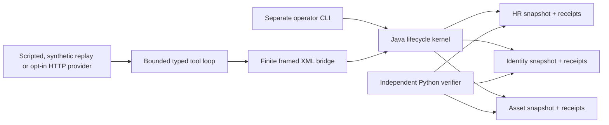

# Lifecycle architecture, authority and tradeoffs

The provider interface returns one `ToolCall` or `FinalDraft`. It can inspect this employee, read one policy, propose offboarding, inspect the workflow, execute a frozen step ID, verify or request local handoff. The Python validator rejects unknown tools and extra/non-string arguments. Java repeats schema, employee/workflow scope and authorization checks; Python validation is not the authority boundary.

Actor and operator run in separate invocations. Only operator mode offers fixture initialization, review, approval and reporting. Operator review serializes the frozen digest and concrete fields. Approval passes that reviewed digest back, and Java rejects a changed digest instead of silently approving a new plan. The eligible fictional approver is `hr-reviewer`.

Java computes the digest from sorted key/value fields encoded with UTF-8 byte lengths, including ordered steps, policy, employee/event, original record versions, grants, laptop and the rule never to restore departure access. Every new service operation checks approval/expiry/effective time and expected record versions. Completed workflow-owned writes advance expected versions through their receipts. A changed service version makes remaining approval stale.

The finite XML envelope has protocol/schema version 1, at most 20 request fields, two element levels and a 64 KiB frame. The Java parser disables DTD, external entities and external schemas, applies a parser depth limit and denies external resolution. Unknown fields/versions, nested nodes and duplicates are rejected. Pipe requests have five-second wall deadlines; only the owned child can be terminated by the bridge. No arbitrary shell/path tool exists.

The HR, identity and asset stores are separate immutable snapshots. A service operation writes its new state and stable operation receipt together. The workflow first commits an intent, invokes the service, then commits an acknowledgement. A restart queries that service receipt: a committed result advances the original step; a definitely absent receipt allows the same bounded action again. Operation keys and payload hashes stay stable across retries. A receipt conflict fails closed.

Snapshot writes flush the temporary file with `FileChannel.force(true)`, then atomically move to a new generation name. Startup loads the highest committed generation, ignores unfinished temporary files and rejects corrupt/unknown-schema committed files. Unsupported atomic move has no non-atomic fallback. A single file lock coordinates cooperating process access to one run directory. No filesystem power-loss guarantee, HA or tamper-proof log is claimed.

M2 extends the original M1 architecture with two onboarding bundles, five forward steps, four owned-resource compensation steps, authoritative HR successor fencing and an exact pre-state approval. It persists 24 provider turns, 32 actor calls, 120,000 milliseconds of active reservations, three attempts per operation and a separate twelve-call safety allowance. Java performs bounded safety cleanup on provider failure, cancellation or budget exhaustion. Asset failure never restores departed access. Operator approvals and idle time are separate from actor reservations. See m2-contract.md for the accepted finite rules.

M3 source adds HTTP and synthetic replay through the same typed loop, while retaining Java and the M2 verifier unchanged. The provider makes one decision from request/tool observations; it cannot mutate an approval or fill mutation payloads. HTTP replies preserve tool-call IDs and opaque reasoning items, and are independently validated. Refusal or failure stops decisions; a final draft cannot change status. Providers cannot read evaluation data. Live compatibility is unverified, and scripted fixture approvals cannot choose the live route.

The evaluation operator owns seed/control schedules. After actor close, a separate Python scorer checks the frozen label with the original verifier and computes independent state/history denominators. It retains incomplete revocation even when an expected outage passes, and preserves failed/unmeasured rows. This is independence from the Java predicate and actor prose, not independent data provenance. Evaluation policy, local authority and both offline providers share a deliberately narrow finite design.

The standard-library XML bridge avoids Maven/pip downloads but requires explicit finite schemas in two languages. Immutable bounded snapshots make receipts and crash windows inspectable, with greater storage and no general query/index/transaction facility. Process restart covers lost acknowledgements across three adapters in one cooperating local process; it does not establish distributed-service atomicity. The actor may be unnecessary for routine fixed-policy execution: the comparison includes a fixed baseline for that reason. Original contribution lies in multi-service business postconditions, partial failure visibility and owned compensation, not a novel generic workflow framework.

Current limits include one trusted operator, one active workflow, at most sixteen serial events, no rehire/mover support, no schema migration of old M1 runtime directories, no production account integrations and no physical return proof. Same-user arbitrary file edits, power loss, damaged storage, network shares and external session/token semantics are outside the contract. M3 integration, heldout scoring, copied quickstart and hosted CI remain unexecuted at source readiness. Subsequent completed local integration, heldout comparison and copied quickstart evidence is recorded in [current local results](../EVIDENCE.md#current-local-results-8-october-2026). Hosted CI remains unexecuted.
